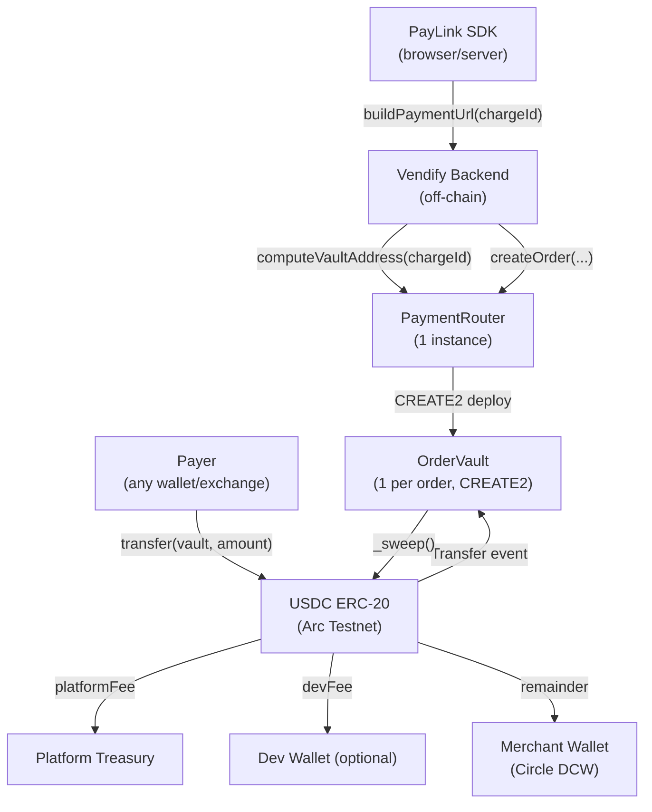

# PaymentRouter + OrderVault — Smart Contract Design Doc

**Status:** Draft  
**Authors:** Vendify Engineering  
**Target chain:** Arc Testnet (chain ID 2818) → Arc Mainnet  
**Language / toolchain:** Solidity 0.8.28, Foundry (Forge + Cast)  
**EVM target:** Paris (Arc constraint — no Cancun opcodes)  
**Milestone:** Sprint 1 — Onchain Payment Primitive  
**Reviews:**
- [ ] Design review
- [ ] Security review
- [ ] Ops review

---

## Action Items (living)

_Empty — fill after each review round._

---

## Goals / Non-Goals

### Goals
- Deploy a deterministic deposit address per order via CREATE2 so any USDC transfer to that address (from wallet, exchange, or any app) is attributed to the correct order
- Distribute each payment atomically: platform fee → dev fee (optional) → merchant remainder
- Handle partial payments: accumulate until `expectedAmount` is met before sweeping
- Accept overpayments: excess goes to merchant (no refund complexity)
- Allow merchant-initiated refunds of un-swept balances
- Emit events sufficient for the backend to update order status and stock without polling

### Non-Goals
- Multi-token support (USDC only in V1)
- Order cancellation onchain (off-chain concern — backend stops monitoring the vault)
- Onchain order expiry / auto-refund on expiry (merchant decides off-chain)
- Upgradeable proxy (V1 is immutable; migration is deploy-new + re-point)
- Mainnet deploy in this sprint (testnet only)

---

## Requirements

### Functional
- `PaymentRouter.createOrder(chargeId, merchant, devWallet, amount)` deploys (or predicts) an `OrderVault` via CREATE2 and emits `OrderCreated`
- `PaymentRouter.computeVaultAddress(chargeId)` returns the deterministic address without deploying — used by the backend to generate the payment URL before any onchain action
- Any USDC `transfer` to an `OrderVault` address triggers accumulation logic
- When accumulated `received >= expectedAmount`, the vault sweeps: distributes fees atomically, emits `PaymentReceived`
- Partial payments emit `PartialPaymentReceived` and leave the vault active
- Overpayments are fully swept to the merchant; no auto-refund
- Merchant (or router owner) can call `refund(vault, recipient)` to return accumulated balance to a specified address

### Security
- No path lets a non-owner set `platformTreasury`, `platformFeeBps`, or `devFeeBps`
- Fee basis points must always sum ≤ 10000 (100%)
- `OrderVault` only accepts the USDC token configured at deploy time; any other token call is ignored or rejected
- Reentrancy must not allow double-sweep: CEI ordering + `nonReentrant` on sweep
- `chargeId` must map 1-to-1 to a vault address; duplicate `createOrder` on the same `chargeId` reverts
- All ETH/native sent to vault or router is rejected

---

## Terminology & Actors

| Term | Definition |
|---|---|
| `chargeId` | UUID (bytes32) identifying a single Order in Vendify's DB |
| `OrderVault` | Deterministic contract (one per order) that holds USDC until paid in full |
| `PaymentRouter` | Factory + config contract deployed once per platform |
| Merchant | The Vendify tenant receiving payment; holds a Circle developer-controlled wallet |
| Payer | The buyer who sends USDC to the vault — may be a wallet app, exchange withdrawal, or any EOA/contract |
| Platform | Vendify — takes `platformFeeBps` of each payment |
| Developer | SDK integrator who built on top of Vendify; takes `devFeeBps` (optional, `address(0)` = skip) |
| `platformTreasury` | Address receiving platform fees |

| Actor | On/off-chain | Trust level | Capabilities |
|---|---|---|---|
| Platform owner | Off-chain admin | Trusted | Set fees, set treasury, pause (V2) |
| Merchant | Off-chain EOA / Circle DCW | Semi-trusted | Receives payment; can call `refund` on their vault |
| Payer | Off-chain EOA or contract | Untrusted | Sends USDC to vault address |
| `PaymentRouter` contract | Onchain | Trusted (own code) | Deploys vaults, distributes fees |
| `OrderVault` contract | Onchain | Trusted (own code, router-initialized) | Accumulates USDC, triggers sweep |

---

## Language / Runtime

- Solidity `^0.8.28` — checked arithmetic by default; no `unchecked` blocks needed for fee math (amounts are bounded by USDC supply)
- EVM target: Paris (Arc Testnet/Mainnet constraint — no `PUSH0`, no `MCOPY`, no transient storage)
- OpenZeppelin 5.1.0 (pre-installed, Paris-compatible): `Ownable2Step`, `ReentrancyGuard`, `SafeERC20`, `IERC20`
- No UUPS proxy in V1 — immutable. Migration path: deploy new router, SDK config points to new address

---

## Transaction & Execution Model

Execution is atomic per transaction. The key re-entry surfaces are:

1. **`_sweep()` in `OrderVault`** — calls `IERC20.transfer` three times (platform, dev, merchant). Uses CEI: all state updates (`received`, `swept` flag) happen before external calls. `nonReentrant` guard on `receivePayment` and `_sweep`.
2. **`createOrder` in `PaymentRouter`** — deploys a contract via `new OrderVault{salt:...}(...)`. No external calls after deployment; no re-entry surface.
3. **`refund` in `PaymentRouter`** — external call to `IERC20.transfer`. Called only by router owner or merchant; state update (`vaultRefunded` mapping) before transfer.

USDC is a known, non-rebasing, non-fee-on-transfer token on Arc. Balance-delta assertions are not required but the sweep reads `balanceOf(vault)` at sweep time (not a stored value) to capture any extra USDC sent directly without calling `receivePayment`.

---

## Chain Standards & Interfaces

- USDC ERC-20: `transfer(to, amount)` + `balanceOf(account)`. No `permit` or `transferFrom` needed — payer sends directly to vault address.
- No ERC-1271, no Permit2 in V1.

---

## Architecture Overview

### Component diagram



### Sequence: happy path (full payment)

```mermaid
sequenceDiagram
    participant B as Backend
    participant R as PaymentRouter
    participant V as OrderVault (not yet deployed)
    participant P as Payer
    participant U as USDC

    B->>R: computeVaultAddress(chargeId) → 0xVault
    B-->>B: store (chargeId → 0xVault) in DB, generate payment URL
    B->>R: createOrder(chargeId, merchant, devWallet, expectedAmount)
    R-->>V: CREATE2 deploy OrderVault
    R-->>R: emit OrderCreated(chargeId, 0xVault, merchant, expectedAmount)
    P->>U: transfer(0xVault, fullAmount)
    U-->>V: Transfer event, vault balance increases
    V->>V: received += fullAmount; received >= expectedAmount → _sweep()
    V->>U: transfer(platformTreasury, platformFee)
    V->>U: transfer(devWallet, devFee)  [if devWallet != address(0)]
    V->>U: transfer(merchant, remainder)
    V-->>V: emit PaymentReceived(chargeId, payer, totalReceived)
    B-->>B: webhook/log → mark order PAID, update stock
```

### Sequence: partial payment then completion

```mermaid
sequenceDiagram
    participant P as Payer
    participant V as OrderVault
    participant U as USDC

    P->>U: transfer(vault, partialAmount)
    U-->>V: balance increases; received < expectedAmount
    V-->>V: emit PartialPaymentReceived(chargeId, payer, partialAmount, pendingAmount)
    Note over V: vault stays active; no sweep
    P->>U: transfer(vault, remainingAmount)
    U-->>V: balance sufficient; received >= expectedAmount → _sweep()
    V-->>V: emit PaymentReceived(chargeId, payer, totalReceived)
```

### Flow of funds

| Step | Who moves what | Invariant |
|---|---|---|
| Payer → Vault | USDC ERC-20 transfer | Vault balance increases monotonically |
| Vault → Platform treasury | `platformFeeBps / 10000 * totalReceived` | Platform gets its cut atomically |
| Vault → Dev wallet | `devFeeBps / 10000 * totalReceived` (if devWallet != 0) | Dev gets cut atomically |
| Vault → Merchant | remainder after fees | Merchant gets at least `(10000 - platformFeeBps - devFeeBps) / 10000 * expectedAmount` |
| **Resting state** | | **Vault holds zero USDC after a successful sweep. Router holds zero USDC at all times.** |

---

## Contract Design

### Roles

| Role | Holder | Permissions | Why it exists |
|---|---|---|---|
| `owner` (Ownable2Step) | Platform deployer (multisig in prod) | Set fees, set treasury, call `refund` on any vault | Platform governance |
| Merchant | Per-order, set at `createOrder` | Call `refund` on their own vault | Merchant can recover over-sent / stuck funds |
| Payer | Untrusted | Transfer USDC to vault address | No onchain role — just sends |

### Storage layout — `PaymentRouter`

```
address   public  usdcToken           // immutable after deploy
address   public  platformTreasury    // mutable by owner
uint16    public  platformFeeBps      // 0-10000; e.g. 100 = 1%
uint16    public  defaultDevFeeBps    // per-SDK-developer default
mapping(bytes32 => address) public vaults  // chargeId → vault address
mapping(address => bool)    public isVault // vault address → bool (auth guard)
```

### Storage layout — `OrderVault`

```
address   public  router              // immutable
address   public  usdcToken           // immutable
bytes32   public  chargeId            // immutable
address   public  merchant            // immutable
address   public  devWallet           // immutable (address(0) if no dev fee)
uint256   public  expectedAmount      // immutable
uint256   public  received            // mutable, accumulates
bool      public  swept               // mutable, set to true after sweep
uint16    public  platformFeeBps      // copied from router at deploy time (immutable)
uint16    public  devFeeBps           // copied at deploy time (immutable)
address   public  platformTreasury    // copied at deploy time (immutable)
```

Fees are snapshotted at vault creation so a fee change by the owner doesn't affect in-flight orders.

### Events

```solidity
// PaymentRouter
event OrderCreated(bytes32 indexed chargeId, address indexed vault, address indexed merchant, uint256 expectedAmount);
event FeesUpdated(uint16 platformFeeBps, uint16 defaultDevFeeBps);
event TreasuryUpdated(address newTreasury);

// OrderVault
event PaymentReceived(bytes32 indexed chargeId, address indexed payer, uint256 totalReceived, uint256 platformFee, uint256 devFee, uint256 merchantAmount);
event PartialPaymentReceived(bytes32 indexed chargeId, address indexed payer, uint256 amountReceived, uint256 totalReceived, uint256 stillPending);
event PaymentRefunded(bytes32 indexed chargeId, address indexed recipient, uint256 amount);
```

### Functions — `PaymentRouter` (write)

| Function | Caller | State mutated | Events | Revert conditions |
|---|---|---|---|---|
| `constructor(usdc, treasury, platformBps, devBps)` | Deployer | Sets all immutables | — | `platformBps + devBps > 10000`; zero `usdc` or `treasury` |
| `createOrder(chargeId, merchant, devWallet, amount)` | Backend / SDK (anyone) | `vaults[chargeId]`, `isVault[vault]` | `OrderCreated` | `chargeId` already registered; zero `merchant` or zero `amount` |
| `setFees(platformBps, devBps)` | `onlyOwner` | `platformFeeBps`, `defaultDevFeeBps` | `FeesUpdated` | sum > 10000 |
| `setTreasury(newTreasury)` | `onlyOwner` | `platformTreasury` | `TreasuryUpdated` | zero address |
| `refund(vault, recipient)` | `onlyOwner` OR msg.sender == vault.merchant | calls `vault.refund(recipient)` | (emitted by vault) | vault not registered; zero recipient |

### Functions — `OrderVault` (write)

| Function | Caller | State mutated | Events | Revert conditions |
|---|---|---|---|---|
| `constructor(...)` | `PaymentRouter` only | All immutables + `received=0`, `swept=false` | — | |
| `receivePayment(payer)` | Anyone (called by backend hook or by vault itself on direct transfer) | `received` | `PartialPaymentReceived` or triggers `_sweep` | `swept == true` |
| `_sweep()` | Internal only | `swept = true` | `PaymentReceived` | already swept; insufficient balance |
| `refund(recipient)` | `router` only (router checks caller is owner or merchant) | transfers balance out | `PaymentRefunded` | `swept == true`; zero recipient |

> **Design note on direct ERC-20 transfers:** USDC's `transfer` does not call a hook on the recipient. The vault therefore cannot detect a direct transfer automatically. Two options: (a) the backend calls `receivePayment(payer)` after detecting the Transfer event onchain; (b) the vault exposes a permissionless `settle()` that reads `balanceOf(address(this))` and runs the sweep logic. Both are included — `settle()` is the permissionless path that handles the "copy-address-and-send" user who never interacts with the frontend.

---

## Specification table — Payment flow

### Principles
1. Once `swept == true`, the vault never moves funds again.
2. `received` only increases; it is never decremented.
3. Fee distribution is always atomic — all three transfers succeed or all revert.
4. A vault's `expectedAmount` is immutable after creation.
5. The router never holds USDC; it only creates vaults and proxies refund calls.

### Functionalities

| Functionality | Restriction | Note | Event | Audit Note |
|---|---|---|---|---|
| Create vault | Anyone can call | Idempotent on same chargeId: second call reverts | `OrderCreated` | chargeId collision check |
| Predict vault address | Anyone, view | No gas, deterministic | — | |
| Receive partial USDC | Permissionless (direct transfer) | Backend calls `settle()` after seeing Transfer event | `PartialPaymentReceived` | |
| Sweep on full payment | Permissionless trigger via `settle()` | Fees snapshotted at vault creation | `PaymentReceived` | CEI + nonReentrant |
| Overpayment | Full amount swept | Excess goes to merchant | `PaymentReceived` with actual amount | No refund of excess |
| Refund | Owner or merchant only, via router | Only if not yet swept | `PaymentRefunded` | Caller check in router |
| Update fees | Owner only | Does NOT affect existing vaults | `FeesUpdated` | Snapshot at vault creation protects in-flight orders |
| Update treasury | Owner only | Does NOT affect existing vaults | `TreasuryUpdated` | Same snapshot protection |

---

## Deployment & Initialization

- `PaymentRouter` is deployed once per environment (testnet / mainnet)
- Constructor args: `usdcToken`, `platformTreasury`, `platformFeeBps`, `defaultDevFeeBps`
- On Arc Testnet: `usdcToken = 0x3c499c542cEF5E3811e1192ce70d8cC03d5c3359` (USDC Arc Testnet — verify from `@/onchain-facts`)
- `platformTreasury` = platform deployer wallet at genesis; transfer ownership to multisig post-deploy
- `OrderVault` is never deployed directly — only via `PaymentRouter.createOrder` using CREATE2
- CREATE2 salt = `keccak256(abi.encode(chargeId))` — deterministic, unique per chargeId

---

## Upgradeability

V1 is immutable. Migration story: deploy new `PaymentRouter`, update `VITE_PAYMENT_ROUTER_ADDRESS` in SDK config. Old vaults continue to work against the old router. New orders use the new router. No dual-run needed — each vault is independent.

---

## Key Management & Signing

- No off-chain signatures in V1
- `onlyOwner` functions use `Ownable2Step` (two-step transfer — current holder proposes, new holder accepts)
- Platform deployer key: cold wallet at genesis; transfer to Gnosis Safe multisig before mainnet

---

## Security Considerations

| Vulnerability | Applicable? | Mitigation |
|---|---|---|
| Reentrancy | Yes — `_sweep` calls `transfer` 3×, `refund` calls `transfer` 1× | CEI ordering: `swept = true` and `received` snapshot before all transfers; `nonReentrant` on `settle()` and `refund` |
| Access control | Yes | `setFees`, `setTreasury` behind `onlyOwner`; `refund` behind owner-or-merchant check in router |
| Integer overflow/underflow | Solidity 0.8 checked | No `unchecked` blocks |
| Unchecked external call | Yes — USDC transfers | `SafeERC20.safeTransfer` for all USDC moves |
| Fee-on-transfer / rebasing tokens | N/A | Only USDC (known non-rebasing, non-fee-on-transfer on Arc) |
| Signature replay | N/A | No off-chain signatures in V1 |
| Front-running / MEV | Low | Vault address is public; amounts are fixed; no value in front-running a deposit |
| Flash-loan / price manipulation | N/A | No price oracle used |
| Denial of service | Low | No loops; pull-over-push for fees; `refund` is pull |
| Delegatecall / proxy safety | N/A | No proxy in V1 |
| Timestamp / block dependence | N/A | No time-based logic onchain; expiry is off-chain |
| Approval persistence | N/A | Vault receives via direct transfer; no `approve`/`transferFrom` |
| Centralization risk | Yes | Owner can change fees/treasury; mitigated by fee snapshot at vault creation (in-flight orders unaffected); multisig on mainnet |
| Vault address squatting | Yes | Any caller can `createOrder` — an adversary could register a `chargeId` with a different merchant before the backend does. Mitigation: `createOrder` is callable by anyone but the backend generates `chargeId` server-side (UUID v4, unguessable). For higher security in V2: restrict `createOrder` to a whitelisted backend address. |
| Direct ERC-20 transfer detection | Yes | Vault exposes permissionless `settle()` that reads `balanceOf` — handles "copy-paste" payers who never hit the frontend. Backend also calls `settle()` after detecting Transfer event. |

---

## Trust Model & Threat Analysis

| Actor | Compromised | Max damage | Mitigation | Detection |
|---|---|---|---|---|
| Platform owner key | Attacker gains owner role | Change treasury/fees for FUTURE orders; cannot steal from existing vaults (fees snapshotted) | Multisig on mainnet; `Ownable2Step` prevents accidental transfer | On-chain `OwnershipTransferred` event |
| Platform treasury address | Attacker controls treasury | Receives platform fees going forward | Replace treasury via `setTreasury`; rotate immediately | Off-chain monitoring |
| Merchant wallet | Attacker controls merchant address | Receives merchant payments going forward; can call `refund` to drain un-swept vaults | Circle DCW with HSM backing; not in scope for this contract | |
| `PaymentRouter` contract | Bug in contract | In V1 (immutable), a critical bug requires migrating to a new router; existing vaults continue with old router | Audit + tests + testnet validation before mainnet | |

---

## Emergency Response

V1 has no onchain pause. Emergency playbook:
1. Stop backend from calling `createOrder` (new orders go to a new router)
2. Existing vaults continue to function — payers can still complete payments
3. If a vault has stuck funds: owner or merchant calls `refund(vault, safeAddress)`
4. V2 will add a `pause()` / `unpause()` guarded by a separate Pauser role

---

## Failure Scenarios

**Scenario 1: Partial payment, payer goes offline**  
Vault accumulates partial USDC. `received < expectedAmount`. Vault stays active. Merchant sees "partial payment" in dashboard. Merchant sends WhatsApp reminder. If order is cancelled, merchant calls `refund(vault, merchant)` to recover partial funds.

**Scenario 2: Payer sends from a centralized exchange (no memo)**  
Transfer hits vault address. Backend detects `Transfer(from, vault, amount)` event. Backend calls `settle()` on vault. Sweep proceeds normally. No frontend interaction needed.

**Scenario 3: `_sweep` fails (e.g. USDC transfer to merchant reverts)**  
With `SafeERC20.safeTransfer`, a failed transfer reverts the entire sweep transaction. `swept` remains false. Vault is still active. Payer or backend can retry `settle()`. Root cause is a blacklisted merchant address — merchant must update their Circle wallet.

**Scenario 4: `createOrder` called twice with same `chargeId`**  
Second call reverts: `vaults[chargeId] != address(0)`. Backend deduplication also prevents this, but the contract is the authoritative guard.

---

## Priorities & Tradeoffs

| Decision | Tradeoff | Rationale |
|---|---|---|
| Fees snapshotted at vault creation | Owner can't retroactively capture more fees from in-flight orders | Protects merchant and payer; owner can only affect future orders |
| Overpayment goes to merchant | Payer may lose excess | No reverse-transfer complexity; merchant can manually refund if they choose |
| No onchain expiry | Vault stays live forever | Simplicity; expiry is a backend concern |
| `settle()` is permissionless | Anyone can trigger the sweep | Necessary for the "copy-paste payer" flow; no harm since sweep only distributes to correct recipients |
| `createOrder` is permissionless | chargeId squatting risk | Mitigated by UUID entropy; V2 will add a backend-signer requirement |
| Immutable in V1 | No bug fix without new deploy | Simpler, smaller attack surface; testnet + audit before mainnet |

---

## Testing Strategy

- **Unit tests (Forge):** happy path, partial payment flow, overpayment, double-createOrder revert, fee math fuzzing, refund access control, `settle()` idempotency after sweep
- **Fuzz:** `platformFeeBps + devFeeBps` never > 10000; fee distribution always sums to `totalReceived`
- **Invariants:** `swept == true → vault USDC balance == 0`; `received` is monotone
- **Static analysis:** Slither on both contracts
- **Fork test:** Arc Testnet fork with real USDC balance

Run: `forge test -vvv` and `forge test --gas-report`

---

## Third-party Libraries

| Library | Version | Already a dep? | Why | Security reviewed? |
|---|---|---|---|---|
| OpenZeppelin Contracts | 5.1.0 | Yes (pre-installed) | `Ownable2Step`, `ReentrancyGuard`, `SafeERC20`, `IERC20` | Yes (audited by OZ) |

---

## Monitoring & Alerting

| Event | Threshold | Severity | Action |
|---|---|---|---|
| `PaymentReceived` | Any | Info | Mark order PAID in DB, update stock, notify merchant |
| `PartialPaymentReceived` | Any | Warning | Update order balance in DB, send WhatsApp reminder |
| `PaymentRefunded` | Any | Info | Mark charge as refunded in DB |
| `FeesUpdated` | Any | High | Alert platform ops — verify intentional |
| `OwnershipTransferred` | Any | Critical | Immediate ops response |
| Vault USDC balance > 0, `swept == false`, order age > 24h | Any | Warning | Dead vault check — contact merchant |

---

## Common Patterns / Worked Examples

### Example 1: Neumáticos Mayorista → Link de cobro → Pago completo

```
1. Backend: chargeId = "550e8400-e29b-41d4-a716-446655440000" (UUID)
2. Backend: vaultAddr = router.computeVaultAddress(chargeId) → 0xABC...
3. Backend: paymentUrl = "https://pay.vendify.app?vault=0xABC&amount=304.00&chargeId=..."
3. Backend: router.createOrder(chargeId, merchantWallet, devWallet, parseUsdc("304.00"))
4. Merchant: sends paymentUrl via WhatsApp to buyer
5. Buyer: transfers 304 USDC directly to 0xABC from Binance
6. Backend: sees Transfer(from=binance, to=0xABC, 304e6) in eth_getLogs
7. Backend: calls vault.settle() → triggers _sweep()
8. _sweep():
     platformFee = 304 * 100 / 10000 = 3.04 USDC → platformTreasury
     devFee      = 304 *  50 / 10000 = 1.52 USDC → devWallet
     remainder   = 304 - 3.04 - 1.52 = 299.44 USDC → merchant
9. Emits: PaymentReceived(chargeId, binance, 304e6, 3.04e6, 1.52e6, 299.44e6)
10. Backend: marks order PAID, decrements stock, generates invoice PDF
```

### Example 2: Pago parcial + recordatorio

```
1. Vault created for chargeId, expectedAmount = 100 USDC
2. Buyer sends 60 USDC → vault.received = 60e6 < 100e6
3. Emits: PartialPaymentReceived(chargeId, buyer, 60e6, 60e6, 40e6)
4. Dashboard shows: "Pago parcial recibido: $60.00 / $100.00 pendiente $40.00"
5. Merchant clicks "Recordar pago" → WhatsApp: "Hola, falta $40 a la misma dirección 0xABC"
6. Buyer sends 40 USDC → vault.received = 100e6 >= 100e6 → _sweep()
7. PaymentReceived emitted with totalReceived = 100e6
```
